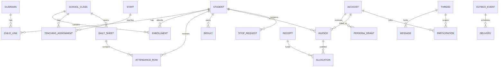

# Records and state transitions at module boundaries

Use this sheet to join the owners' APIs without reimplementing their business rules. Labels in the relationship diagram are **conceptual entity names**. The module cards determine physical names, fields, grants, transactions and DTOs. [Contracts](contracts.md) defines one actor/transaction boundary for both clients.

A guardian profile can exist before an account is activated. The active family link, teacher assignment, historic payer and thread participant are different authorization predicates. Every report or dashboard counter must use its own source predicate. Date-dependent joins use school-local effective dates; clinical/private explanations belong only in their protected source record.

| Aggregate and owner | Transition and authority | Guard, retry and visible effect |
|---|---|---|
| Import and family link · S02/S04/I04 | Staff maps file → previews decisions → explicitly commits approved records → separately authorizes invitations. Manual entry joins at link approval. | Unresolved matches require a decision or skip; withdrawn links never resurrect by repeat import. Existing verified family gets one link notice. |
| Enrollment and staffing · S03/S05/S06 | Staff creates class → appoints day lead and subject teachers → places pupils with effective date → schedules noncolliding sessions. Transfer, year rollover and substitution change future scope. | One primary enrollment at a time, dated authorized substitute. Historical sheets/results keep original class and year. |
| Daily attendance · A01–A04 | Scheduled day starts unmarked. Guardian sends an excuse → locked excused row. Authorized teacher deliberately records arrival present/late or completes other rows → approves snapshot. Supervisor corrects finalized record with reason. | Offline drafts do not commit a transition. Actual arrival has priority; stale changes require re-read. Approved unexcused absence schedules a per-guardian alert, correction cancels or follows delivered alerts. |
| Teaching, evaluation and exam · E01–E07 | Subject teacher drafts/publishes plan → records actual lesson. Homework marks become visible at recording. Exam/evaluation draft → reviewed/published → audited correction. | Grade 0 differs from no mark. Scoped reports read committed visible revisions; correction event deduplicates recipient notices. |
| Invoice and receipt · B01–B04 | Authorized staff previews/commits issue for child/month and named payer. Verified external payment → manual receipt → exact-match or explicit allocation. Outstanding/partial/paid are derived balances. | Guard child/month uniqueness, active bank, currency, named payer and amounts. Reversal is a new ledger posting. Copying IBAN/reference leaves the ledger untouched. |
| Stop request · B05/S03 | Linked guardian requests last attended month + duration/reason → pending → withdrew, rejected or approved by authorized staff as applicable. | Pending holds reminders only for that interval. Approval affects that child's effective enrollment/billing; a previously paid/part-paid debt requires a separate finance review. |
| Human message and delivery · C01–C07 | Sender uploads or composes → server commits message/sequence → read cursor advances per recipient. Personal archive can be reversed by new message. Source event → pending recipient/channel dispatch → accepted, failed/retry or uncertain outcome requiring reconciliation. | Provider acceptance, physical delivery and opened/read are distinct. A 48-hour unread reminder is based on the first outstanding human message, rechecks current access/read state and deduplicates. DM content remains participant-only. |

For actual writes use the API on the owning card. Avoid parallel “quick actions” that independently change a grade, balance or attendance flag. Quick actions from a dashboard call the same command as the detail page.
